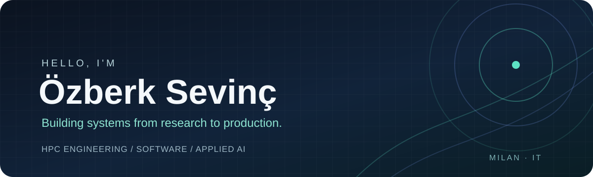

  

  <strong>HPC Engineering @ Politecnico di Milano</strong> &nbsp;·&nbsp; CTO @ OtrantoConnect &nbsp;·&nbsp; Milan, Italy

  <a href="https://www.linkedin.com/in/ozberksevinc/">LinkedIn</a> &nbsp;•&nbsp;
  <a href="https://github.com/ozberk-sevinc?tab=repositories">Projects</a> &nbsp;•&nbsp;
  <a href="https://github.com/ozberk-sevinc/larPlayer">LARPlayer</a>

---

### Hey, I'm Özberk 👋

I like taking ideas from a research notebook to a working product. I'm pursuing an **MSc in High Performance Computing Engineering** at Politecnico di Milano after a **BSc in Applied Computer Science and Artificial Intelligence** at Sapienza University of Rome. My work moves between performance, machine learning, backend systems, and the details that make software pleasant to use.

At **OtrantoConnect**, I lead the technical direction of a CRM for education consultancies across web, mobile, backend, and deployment. I also work on Kotlin and Spring services with the **WENO** backend team.

### Building now

| Project | What it does | Stack / focus |
| :-- | :-- | :-- |
| **[LARPlayer](https://github.com/ozberk-sevinc/larPlayer)** | A lightweight Windows terminal player with Spotify Connect playback, playlists, global shortcuts, and a live RAM meter. | C++20 · Windows · terminal UI |
| **[CRM-Soru](https://github.com/ozberk-sevinc/crm-soru)** | Daily IMAT and TOLC practice with a mistake notebook and learning-outcome insights for students. | React Native · Expo · Go |
| **OtrantoConnect** | A CRM platform for education consultancies, delivered across web, mobile, and backend services. | Go · React · infrastructure |

### Research & experiments

- **Formula 1 lap-time analysis** — Co-authored an analysis of roughly **60,000 laps** across wet and dry conditions, comparing Random Forest, LightGBM, and polynomial regression; used SHAP to interpret model behaviour.
- **Chess from images** — Co-developed a vision pipeline using two YOLOv11-nano models for board corners and pieces, with a reported **94% test-set mAP**; used OpenCV homography to map detections to an 8×8 board.
- **FOMC communication & NASDAQ volatility** — My bachelor thesis uses transformer-based NLP and one-minute event-window data to examine whether central-bank communication improves intraday volatility prediction.

### Tools I reach for

`Python` `C++` `Go` `Kotlin` `Java` `SQL` `React` `Spring` `Docker`  
`PyTorch` `scikit-learn` `LightGBM` `SHAP` `OpenCV` `YOLO` `MATLAB`

<strong>A little more about me</strong>

I contributed to the **Sapienza Foiling Team** on a university sailboat design project. I speak **Turkish** (native), **English** (C1; IELTS 8.0), and **Italian** (A2). I'm especially interested in projects where careful engineering and real-world usefulness meet.

Built with curiosity in Milan · <a href="https://www.linkedin.com/in/ozberksevinc/">Let's connect</a>

